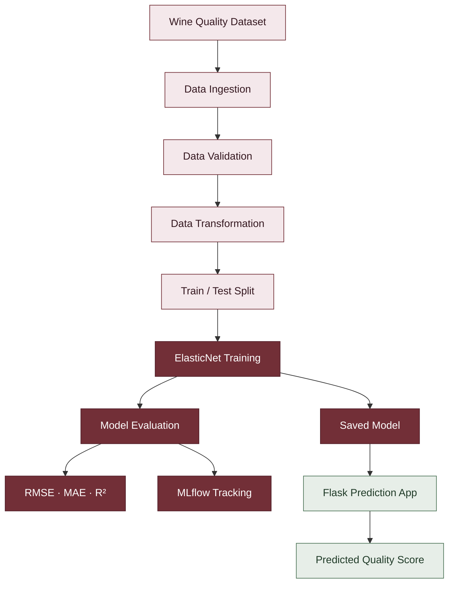
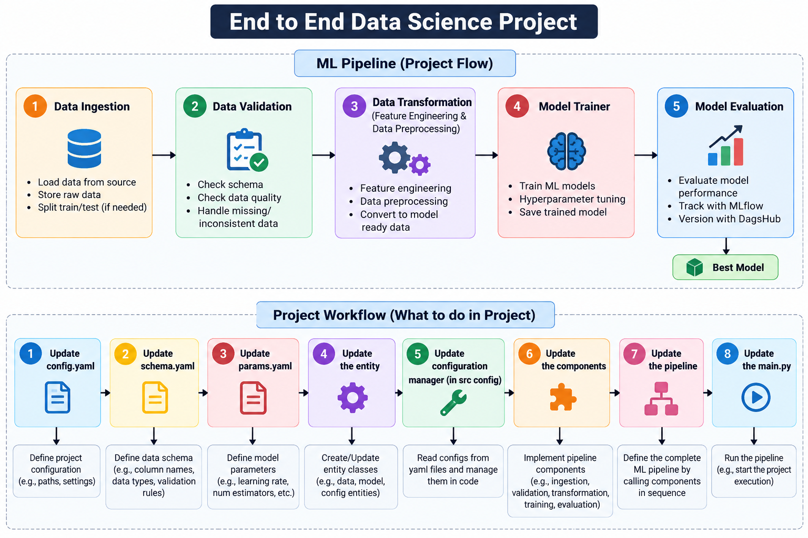
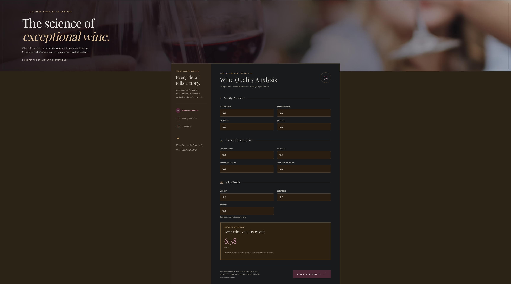

# 🍷 Wine Quality Prediction

<p align="center">
  
    <a href="https://zainulabedeen589.netlify.app/">
    
  </a>
  
  
  
</p>

An end-to-end Machine Learning application that predicts a wine quality score from its physicochemical properties. The project combines a modular ML pipeline, ElasticNet regression, MLflow experiment tracking, model evaluation, and a Flask web interface.

## Overview

Wine quality can be estimated using measurable chemical properties such as acidity, residual sugar, chlorides, sulfur dioxide, density, sulphates, and alcohol content.

This project builds a regression-based prediction system that accepts these measurements and estimates a wine quality score using a trained ElasticNet model.

The application provides a web interface for entering wine characteristics and viewing the predicted score with an interpreted quality label.

> **Disclaimer:** Predictions are estimates produced by a machine learning model. They are not laboratory measurements or professional wine-quality certifications.

## Key Features

- **End-to-end ML workflow:** Data ingestion, data validation, data transformation, model training, and evaluation.
- **ElasticNet regression:** Predicts a numerical wine quality score.
- **MLflow integration:** Logs model parameters, evaluation metrics, and the trained model.
- **DagsHub tracking configuration:** Uses a configured remote MLflow tracking URI.
- **Model evaluation:** Calculates RMSE, MAE, and R².
- **Flask web application:** Accepts 11 physicochemical input features.
- **Input validation:** Checks required values, numeric formats, finite numbers, and configured minimum or maximum values.
- **YAML-based configuration:** Keeps pipeline settings, hyperparameters, and schema information in configuration files.
- **Structured logging:** Records application and pipeline activity.
- **Saved artifacts:** Stores processed datasets, the trained model, validation status, and evaluation metrics.
- **Responsive user interface:** A custom wine-analysis interface branded as *Maison Vigne*.

## Technology Stack

| Category                      | Technologies          |
| ----------------------------- | --------------------- |
| Programming language          | Python                |
| Machine learning              | scikit-learn          |
| Regression algorithm          | ElasticNet            |
| Data processing               | Pandas, NumPy         |
| Model serialization           | Joblib                |
| Web framework                 | Flask                 |
| Experiment tracking           | MLflow                |
| Remote tracking configuration | DagsHub               |
| Configuration                 | YAML                  |
| Frontend                      | HTML, CSS, JavaScript |
| Templates                     | Jinja2 through Flask  |
| Evaluation                    | RMSE, MAE, R²        |

---

## How It Works



The workflow is orchestrated by `main.py`, which runs the pipeline stages sequentially.

---

## Machine Learning Workflow

```text
Wine Quality Dataset
        |
        v
   Data Ingestion
        |
        v
   Data Validation
        |
        v
 Data Transformation
   Train/Test Split
        |
        v
  Model Training
   ElasticNet
        |
        v
 Model Evaluation
 RMSE / MAE / R²
        |
        v
 Save Model + Metrics
        |
        v
 MLflow Experiment Tracking
        |
        v
 Flask Prediction Interface
        |
        v
 Predicted Wine Quality Score
```

The workflow is orchestrated through `main.py`, which executes the pipeline stages sequentially.



## Dataset and Input Features

The project configuration downloads a wine-quality dataset from the following source:

[Wine Quality Dataset — source repository](https://github.com/krishnaik06/datasets)

The configured source URL points to a ZIP archive containing the red-wine dataset.

The prediction interface accepts these 11 input features:

| Feature              | Description                                         |
| -------------------- | --------------------------------------------------- |
| Fixed Acidity        | Acids that contribute to the wine's overall acidity |
| Volatile Acidity     | Volatile acids present in the wine                  |
| Citric Acid          | Citric acid content                                 |
| Residual Sugar       | Sugar remaining after fermentation                  |
| Chlorides            | Chloride content                                    |
| Free Sulfur Dioxide  | Free sulfur dioxide concentration                   |
| Total Sulfur Dioxide | Total sulfur dioxide concentration                  |
| Density              | Density of the wine                                 |
| pH                   | Acidity/alkalinity measurement                      |
| Sulphates            | Sulphate content                                    |
| Alcohol              | Alcohol content                                     |

The target variable is `quality`, a numerical score. The model treats this target as a regression problem.

## Model Configuration

The current model is ElasticNet regression, configured through `params.yaml`.

```yaml
ElasticNet:
  alpha: 0.1
  l1_ratio: 0.5
```

- `alpha`: Controls the overall regularization strength.
- `l1_ratio`: Controls the balance between L1 and L2 regularization.

The model is trained on the training dataset and evaluated against the held-out test dataset.

The current data-transformation component uses a train/test split. Additional preprocessing techniques, feature engineering, and exploratory data analysis are not implemented in that component's current version.

## Model Evaluation

The project calculates three regression metrics and saves them to `artifacts/model_evaluation/metrics.json`.

**Recorded evaluation results**

<p align="center">
  
  
  
</p>

| Metric |  Value | Interpretation                                                          |
| ------ | -----: | ----------------------------------------------------------------------- |
| RMSE   | 0.7651 | Typical error scale, with larger errors penalized more strongly         |
| MAE    | 0.5887 | Mean absolute prediction error                                          |
| R²    | 0.2276 | Approximately 22.8% of target variance explained on the evaluation data |

These results indicate that the model has room for improvement. They should be treated as the recorded evaluation results for the current saved model and dataset split, not as a guarantee of performance on new data.

The evaluation component also logs model parameters, metrics, and model artifacts to MLflow.

## Web Application

The Flask application provides a browser-based interface for wine-quality prediction.

### How it works

1. Open the application in your browser.
2. Enter the 11 physicochemical measurements.
3. Submit the prediction form.
4. The server validates the submitted values.
5. The trained model generates a numerical prediction.
6. The interface displays the predicted score and a descriptive label.

The current application uses these label rules:

- Score at or below 4: **Below Average**
- Score above 4 and at or below 6: **Average**
- Score above 6: **Good**

These labels are application-defined categories; they are not separate outputs produced by the regression model.

### Application endpoints

| Endpoint     | Method | Purpose                                              |
| ------------ | ------ | ---------------------------------------------------- |
| `/`        | GET    | Displays the home page and prediction form           |
| `/predict` | GET    | Displays the prediction form                         |
| `/predict` | POST   | Validates input and returns a prediction             |
| `/health`  | GET    | Returns a basic application health response          |
| `/train`   | GET    | Runs the training script through the web application |

**Operational note:** The `/train` endpoint currently triggers model training through a shell command. Before production use, training should be moved to a protected background job or a separate service. The `/health` endpoint checks basic application responsiveness; it does not verify model-artifact availability or remote tracking connectivity.

## Project Structure

```text
Wine Quality/
├── app.py
├── main.py
├── Workflow.md
├── config/
│   ├── config.yaml
│   └── __init__.py
├── params.yaml
├── schema.yaml
├── artifacts/
│   ├── data_ingestion/
│   ├── data_validation/
│   ├── data_transformation/
│   ├── model_trainer/
│   │   └── model.joblib
│   └── model_evaluation/
│       └── metrics.json
├── notebook/
│   ├── 1_data_ingestion.ipynb
│   ├── 2_data_validation.ipynb
│   ├── 3_data_transformation.ipynb
│   ├── 4_model_trainer.ipynb
│   ├── 5_model_evaluation.ipynb
│   └── notebook.ipynb
├── src/
│   └── datascience/
│       ├── components/
│       ├── config/
│       ├── constants/
│       ├── entity/
│       ├── pipeline/
│       └── utils/
├── templates/
│   ├── index.html
│   └── results.html
├── logs/
│   └── logging.log
├── Dockerfile
└── setup.py
```

*Note: The tree highlights the main files and directories; some directories contain additional Python modules. The supplied `Dockerfile` and `setup.py` are currently empty, and a dependency manifest was not present in the shared project listing.*

## Getting Started

### 1. Clone the repository

Replace the placeholder with your actual repository URL.

```bash
git clone <YOUR_REPOSITORY_URL>
cd Wine Quality
```

### 2. Create and activate a virtual environment

On macOS or Linux:

```bash
python3 -m venv .venv
source .venv/bin/activate
```

Check your Python version:

```bash
python3 --version
```

### 3. Install dependencies

A `requirements.txt` file was not included in the supplied project listing. Create and maintain one with the project's complete, verified dependencies before relying on a fresh environment.

The shared code imports these packages directly:

```bash
python -m pip install flask numpy pandas scikit-learn joblib mlflow pyyaml ensure python-box
```

The full dependency list may require additional packages used by the ingestion, validation, configuration, or other modules. Verify all imports before considering the environment reproducible.

### 4. Run the ML pipeline

From the project root:

```bash
python main.py
```

The pipeline executes data ingestion, validation, transformation, model training, and model evaluation in sequence.

The expected artifact locations include:

```text
artifacts/data_ingestion/
artifacts/data_validation/status.txt
artifacts/data_transformation/train.csv
artifacts/data_transformation/test.csv
artifacts/model_trainer/model.joblib
artifacts/model_evaluation/metrics.json
```

These outputs depend on successful execution of the relevant pipeline stages.

### 5. Configure MLflow tracking

The model-evaluation configuration currently specifies this tracking URI:

```text
https://dagshub.com/zainulabedeen589/mlproject.mlflow
```

Remote tracking may require DagsHub account access and credentials. Configure credentials securely using the supported authentication method, and do not commit access tokens, passwords, or other secrets to the repository.

### 6. Start the Flask application

```bash
python app.py
```

The application is configured to listen on port `8080`.

Open:

```text
http://127.0.0.1:8080
```

The model artifact must exist at the configured path:

```text
artifacts/model_trainer/model.joblib
```

Run the training pipeline first if the artifact is missing.

## Configuration Files

| File                   | Responsibility                                    |
| ---------------------- | ------------------------------------------------- |
| `config/config.yaml` | Data paths, ingestion URL, and artifact locations |
| `params.yaml`        | ElasticNet hyperparameters                        |
| `schema.yaml`        | Expected dataset column types and target column   |
| `Workflow.md`        | Notes describing the development workflow         |

## Logging and Artifacts

The application and pipeline use logging to record activity. The supplied project structure includes:

- `logs/logging.log` — log output.
- `artifacts/data_validation/status.txt` — data-validation status.
- `artifacts/model_trainer/model.joblib` — serialized trained model.
- `artifacts/model_evaluation/metrics.json` — saved evaluation metrics.
- `artifacts/data_transformation/train.csv` and `test.csv` — transformed train/test datasets.

The `artifacts/` directory contains generated data and model files. Decide which artifacts should be version-controlled and which should be generated during setup. Large datasets and model binaries may be better managed through dedicated artifact storage or Git LFS, depending on project needs.

## Current Limitations and Future Improvements

The following are potential next steps, not claims about features already implemented.

- Add a complete, pinned `requirements.txt` or another reproducible dependency manifest.
- Complete and validate the Docker configuration.
- Add automated unit and integration tests.
- Introduce CI checks for linting, tests, and pipeline execution.
- Evaluate stronger regression baselines and compare them against ElasticNet.
- Add systematic feature engineering and exploratory data analysis.
- Improve validation of physically plausible feature ranges.
- Track dataset versions and model versions.
- Add prediction logging, monitoring, and model-drift checks.
- Add authentication and access control before exposing training operations.
- Improve error handling and verify model availability through health checks.
- Add deployment instructions after selecting and testing a target platform.

## Disclaimer

This project is intended for educational and demonstration purposes. Its predictions depend on the training data, model configuration, and evaluation methodology. It should not be used as a substitute for laboratory testing, regulatory certification, or expert assessment.

## 👨‍💻 Author

### Zainul Abedeen

**Machine Learning Engineer | MLOps Enthusiast | AI/ML Developer**

<p align="left">
  <a href="https://github.com/zainulabedeen589">
    
  </a>
  <a href="https://www.linkedin.com/in/zainulabedeen589/">
    
  </a>
  <a href="https://zainulabedeen589.netlify.app/">
    
  </a>
</p>

---



---
